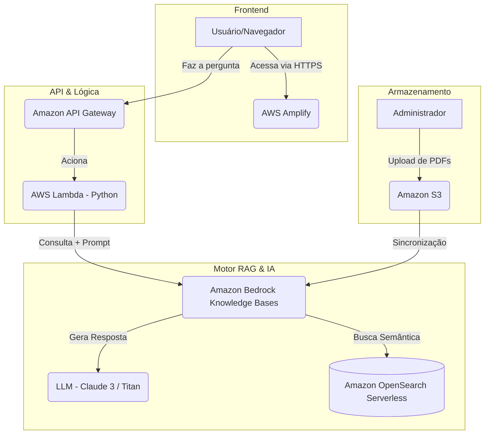

# 🧠 Chatbot RAG Serverless na AWS

Este repositório contém o código-fonte, a infraestrutura e os fluxos de automação (CI/CD) para o deploy de um **Chatbot RAG (Retrieval-Augmented Generation)** hospedado na AWS. A solução utiliza documentos PDF armazenados no Amazon S3 como base de conhecimento para responder a perguntas através do Amazon Bedrock de forma 100% serverless.

---

## 🎯 Objetivo

Criar uma solução didática, escalável e de baixo custo que demonstre como modelos fundacionais (LLMs) podem ser enriquecidos com conhecimento privado corporativo ou acadêmico sem a necessidade de re-treinamento, mitigando alucinações e garantindo rastreabilidade das informações.

---

## 🏗️ Arquitetura da Solução

O fluxo da aplicação é dividido em duas etapas principais: **Ingestão de Dados** e **Inferência/Consulta**.



---

## 📂 Estrutura do Repositório

```text
chatbot-rag-aws/
├── .github/
│   └── workflows/
│       └── deploy-backend.yml      # Pipeline CI/CD para deploy da Lambda
├── backend/
│   └── lambda_function.py          # Código Python da função Lambda
├── frontend/
│   └── index.html                  # Interface gráfica web do Chatbot
└── README.md                       # Documentação do projeto
```

---

## 🛠️ Passo a Passo para Implantação

### Etapa 1: Credenciais, Repositório e Segurança (Setup do Git)

1. **Criar Usuário no IAM da AWS:**
   * Acesse **AWS IAM > Users > Create user**.
   * Nome do usuário: `github-actions-chatbot-deploy`.
   * Em *Permissions*, selecione **Attach policies directly** e anexe a política `AWSLambda_FullAccess`.
   * Após criar, clique no usuário, navegue até a aba **Security credentials** e crie uma **Access Key** (selecione a opção *Command Line Interface (CLI)*).
   * Guarde o **Access Key ID** e a **Secret Access Key**.

2. **Configurar o Repositório no GitHub:**
   * Crie o repositório no GitHub (ex: `chatbot-rag-aws`).
   * Vá em **Settings > Secrets and variables > Actions > New repository secret**.
   * Adicione as seguintes chaves:
     * `AWS_ACCESS_KEY_ID`: ID da chave de acesso copiada.
     * `AWS_SECRET_ACCESS_KEY`: Chave de acesso secreta copiada.

3. **Estrutura Local de Pastas:**
   * Organize o repositório localmente com as pastas `.github/workflows/`, `backend/` e `frontend/`.

---

### Etapa 2: Infraestrutura de Dados na AWS (PDFs, SSM e Bedrock)

1. **Configurar o AWS Systems Manager (Parameter Store):**
   * Acesse **AWS Systems Manager > Parameter Store > Create parameter**.
   * **Nome:** `/chatbot/KNOWLEDGE_BASE_ID`
   * **Tipo:** `String`
   * **Valor temporário:** `A_SER_PREENCHIDO` *(será atualizado no passo 3)*.

2. **Armazenamento no Amazon S3:**
   * Acesse **Amazon S3 > Create bucket**.
   * Defina um nome globalmente único (ex: `meus-pdfs-chatbot-2026`).
   * Faça o upload dos arquivos `.pdf` que servirão de base para o Chatbot.

3. **Motor de IA e RAG no Amazon Bedrock:**
   * Acesse **Amazon Bedrock > Knowledge bases > Create knowledge base**.
   * Defina o nome (ex: `BaseConhecimentoPDFs`).
   * Na seção **Data Source**, escolha `Amazon S3` e selecione o bucket criado (`s3://meus-pdfs-chatbot-2026`).
   * **Embeddings Model:** Selecione `Amazon Titan Embeddings G1 - Text` (ou `v2`).
   * **Vector Store:** Deixe a opção padrão marcada para criar um novo **Amazon OpenSearch Serverless**.
   * Clique em **Create** e, em seguida, clique em **Sync** na fonte de dados para processar os PDFs.
   * Copie o **Knowledge Base ID** gerado.
   * Volte ao **Parameter Store** (SSM) e edite o parâmetro `/chatbot/KNOWLEDGE_BASE_ID`, substituindo pelo ID real.

---

### Etapa 3: Criação da Lambda Shell e API Gateway

1. **Criar a Função AWS Lambda:**
   * Acesse **AWS Lambda > Create function**.
   * **Nome:** `ChatbotRagFunction`
   * **Runtime:** `Python 3.12`
   * Em **Configuration > Permissions**, clique no nome da Role criada (*Execution role*).
   * No IAM, adicione as seguintes políticas gerenciadas à Role:
     * `AmazonBedrockFullAccess`
     * `AmazonSSMReadOnlyAccess`

2. **Configurar o Amazon API Gateway:**
   * Acesse **API Gateway > Create API** e selecione **HTTP API**.
   * **Nome:** `aws-llm-rag-api`
   * **Integração:** Selecione `Lambda` e aponte para `ChatbotRagFunction`.
   * **Rotas:** Método `POST` no caminho `/perguntar`.
   * **Configuração de CORS:**
     * `Access-Control-Allow-Origin`: `*`
     * `Access-Control-Allow-Methods`: `POST, OPTIONS`
     * `Access-Control-Allow-Headers`: `Content-Type`
   * Salve as configurações e copie a **Invoke URL** gerada.

---

### Etapa 4: Código e Pipeline de CI/CD Backend

1. **Pipeline do GitHub Actions (`.github/workflows/deploy-backend.yml`):**
   ```yaml
   name: Deploy Backend Lambda Serverless

   on:
     push:
       branches:
         - main
       paths:
         - 'backend/**'

   jobs:
     deploy:
       runs-on: ubuntu-latest
       steps:
         - name: Baixar Código
           uses: actions/checkout@v3

         - name: Autenticar na AWS
           uses: aws-actions/configure-aws-credentials@v2
           with:
             aws-access-key-id: ${{ secrets.AWS_ACCESS_KEY_ID }}
             aws-secret-access-key: ${{ secrets.AWS_SECRET_ACCESS_KEY }}
             aws-region: us-east-1

         - name: Empacotar código Python
           run: |
             cd backend
             zip -r ../function.zip .

         - name: Atualizar Lambda na AWS
           run: |
             aws lambda update-function-code \
               --function-name ChatbotRagFunction \
               --zip-file fileb://function.zip \
               --publish
   ```

2. **Código da Lambda (`backend/lambda_function.py`):**
   ```python
   import json
   import boto3

   ssm_client = boto3.client('ssm')
   bedrock_agent = boto3.client('bedrock-agent-runtime')

   MODEL_ARN = 'arn:aws:bedrock:us-east-1::foundation-model/anthropic.claude-3-sonnet-20240229-v1:0'

   def obter_kb_id():
       response = ssm_client.get_parameter(Name='/chatbot/KNOWLEDGE_BASE_ID')
       return response['Parameter']['Value']

   def lambda_handler(event, context):
       headers = {
           'Access-Control-Allow-Origin': '*',
           'Access-Control-Allow-Headers': 'Content-Type',
           'Access-Control-Allow-Methods': 'OPTIONS, POST'
       }
       
       if event.get('httpMethod') == 'OPTIONS':
           return {'statusCode': 200, 'headers': headers, 'body': ''}
           
       try:
           body = json.loads(event.get('body', '{}'))
           pergunta = body.get('pergunta')
           
           if not pergunta:
               return {'statusCode': 400, 'headers': headers, 'body': json.dumps({'erro': 'Pergunta não informada'})}
               
           kb_id = obter_kb_id()
           
           response = bedrock_agent.retrieve_and_generate(
               input={'text': pergunta},
               retrieveAndGenerateConfiguration={
                   'type': 'KNOWLEDGE_BASE',
                   'knowledgeBaseConfiguration': {
                       'knowledgeBaseId': kb_id,
                       'modelArn': MODEL_ARN
                   }
               }
           )
           
           resposta_texto = response['output']['text']
           return {
               'statusCode': 200,
               'headers': headers,
               'body': json.dumps({'resposta': resposta_texto})
           }
       except Exception as e:
           return {
               'statusCode': 500,
               'headers': headers,
               'body': json.dumps({'erro': str(e)})
           }
   ```

---

### Etapa 5: Frontend e Deploy no AWS Amplify

1. **Configurar o Frontend (`frontend/index.html`):**
   * Edite a variável `API_URL` substituindo pela URL do API Gateway copiada na Etapa 3.2:
     ```javascript
     const API_URL = "SUA_INVOKE_URL_DO_API_GATEWAY/perguntar";
     ```

2. **Publicação via Git e AWS Amplify:**
   * Envie as alterações para o repositório remoto:
     ```bash
     git add .
     git commit -m "Estrutura completa com CI/CD e Frontend"
     git push origin main
     ```
   * Acompanhe a execução do workflow na aba **Actions** no GitHub.
   * No console da AWS, abra o **AWS Amplify > Host web app**.
   * Conecte a conta do GitHub, escolha o repositório `chatbot-rag-aws` e a branch `main`.
   * Conclua o processo para gerar a URL pública HTTPS da aplicação.

---

## 👤 Autor

* **Pedro Luiz da Silva Pereira**
  * [GitHub](https://github.com/pl-silvapereira/)
  * [LinkedIn](https://www.linkedin.com/in/pedro-luiz-da-silva-pereira/)